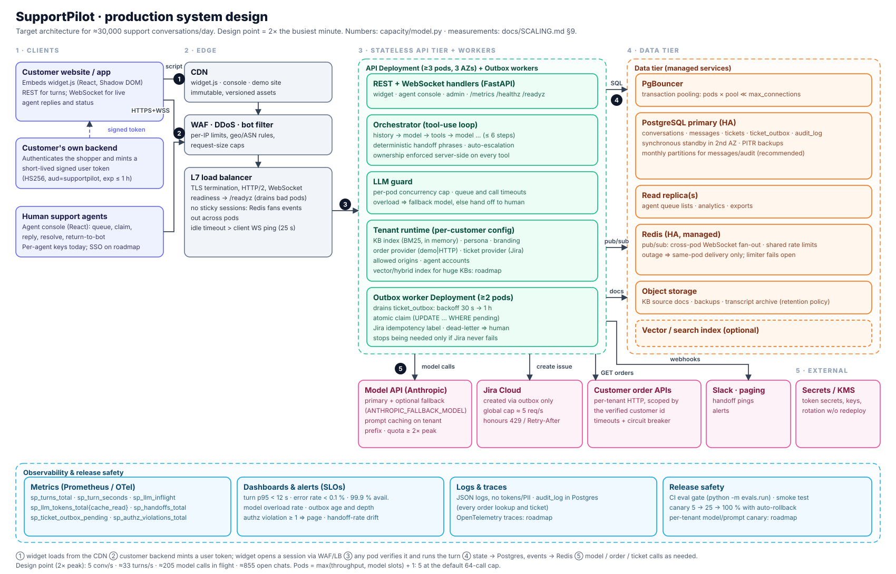

# SupportPilot AI

[](https://github.com/akhil4rajan/supportpilot-ai/actions/workflows/ci.yml)
[](LICENSE)

A multi-tenant, drop-in customer-support AI. One `<script>` tag on any website gives visitors a chat assistant that answers from the company's own docs, looks up *only the signed-in user's* orders, files tickets and hands off to a human.

## Try it in two minutes (no API key needed)

```bash
cp .env.example .env                       # demo secrets; set LLM_PROVIDER=demo to run without a key
cd backend && python -m venv .venv && .venv/bin/pip install -e ".[dev]"
cd ../frontend && npm install && npm run build
cd ../backend && LLM_PROVIDER=demo STATIC_DIR=../frontend/dist .venv/bin/uvicorn app.main:app_factory --factory --port 8000
```

* Demo storefront: <http://localhost:8000/> — switch between Guest / Alice / Bob and chat.
* Agent console: <http://localhost:8000/console/> — company `acme`, key `sam-demo-key`.
* `LLM_PROVIDER=demo` is a keyword stand-in that exercises the real pipeline (auth, KB, tickets, handoff). For real answers pick a provider — see [Choosing an AI provider](#choosing-an-ai-provider).

Dev mode with hot reload: `uvicorn app.main:app_factory --factory --reload` + `cd frontend && npm run dev` (port 5173, proxies `/v1` to 8000).
Docker: `docker compose up --build` (Postgres included).

## What it does

| Capability | How it works |
|---|---|
| **Answer support questions** from *each customer's own* documents | Per-tenant knowledge base (Markdown/text) → chunked, BM25-indexed → the model answers only from retrieved passages, with source citations. A confidence gate stops it guessing. |
| **Check order status — only the user's own orders** | Identity comes from a token signed by the *customer's backend*, never from the chat. Tools can't take a user id; ownership is enforced in 3 layers. |
| **Open a support ticket** | Jira via the [`jira`](https://pypi.org/project/jira/) Python package (pluggable provider). Asks for confirmation first, attaches the transcript, de-duplicates. |
| **Hand off to a human** | Model-initiated, button-initiated, deterministic phrase match ("get me a human"), automatic after repeated failures, or on model outage. Live agent console over WebSocket. |

```
 Customer's site                     SupportPilot (FastAPI)                         Integrations
┌────────────────┐  user token  ┌──────────────────────────────────────┐
│ Customer's own │─ (HS256) ───▶│ /v1/widget/*  session, chat, WS      │      ┌─────────────┐
│ backend        │              │    │                                 │─────▶│ LLM provider│
└────────────────┘              │    ▼                                 │      └─────────────┘
┌────────────────┐  widget.js   │  Orchestrator (tool-use loop)        │      ┌─────────────┐
│ Widget (React, │◀────────────▶│   ├ search_knowledge_base → BM25 KB  │─────▶│ Order API   │ (demo | http)
│ Shadow DOM)    │   REST + WS  │   ├ get_order_status / list_my_orders│      └─────────────┘
└────────────────┘              │   ├ create_support_ticket            │      ┌─────────────┐
┌────────────────┐  REST + WS   │   └ escalate_to_human                │─────▶│ Jira        │ (jira pkg)
│ Agent console  │◀────────────▶│ /v1/agent/*   queue, claim, reply    │      └─────────────┘
│ (React)        │              │ /v1/admin/*   tenants, knowledge     │      ┌─────────────┐
└────────────────┘              │ SQL (SQLite | Postgres)              │─────▶│ Slack hook  │ (optional)
                                └──────────────────────────────────────┘      └─────────────┘
```

## Choosing an AI provider

SupportPilot is model-agnostic. Set `LLM_PROVIDER` (and `LLM_MODEL`) in `.env`; no code changes.

| `LLM_PROVIDER` | Models | Key variable |
|---|---|---|
| `anthropic` | Anthropic (native SDK, prompt caching) | `ANTHROPIC_API_KEY` |
| `openai` | OpenAI | `OPENAI_API_KEY` |
| `gemini` | Google Gemini (OpenAI-compatible endpoint) | `GEMINI_API_KEY` |
| `meta` | Meta Llama API | `LLAMA_API_KEY` |
| `groq`, `together`, `fireworks`, `openrouter` | Llama, Mistral and many others, hosted | `GROQ_API_KEY`, `TOGETHER_API_KEY`, … |
| `mistral`, `deepseek` | Mistral, DeepSeek | `MISTRAL_API_KEY`, `DEEPSEEK_API_KEY` |
| `ollama`, `vllm` | Self-hosted open models (Llama etc.), no key | — |
| `openai_compatible` | Any other endpoint (Azure OpenAI, a gateway…) | `LLM_BASE_URL` + `LLM_API_KEY` |

```bash
LLM_PROVIDER=openai LLM_MODEL=<model-id> OPENAI_API_KEY=...        # example
LLM_PROVIDER=ollama LLM_MODEL=llama3.1                              # fully self-hosted
LLM_PROVIDER=openai LLM_MODEL=<id> LLM_FALLBACK_PROVIDER=groq LLM_FALLBACK_MODEL=<id>   # cross-vendor failover
```

Non-Anthropic providers use the OpenAI-compatible chat-completions API with tool calling, so the chosen model must support tools. The orchestrator uses one internal message format and the client translates, so tool use, handoff and the order-access guarantees are identical across providers (see `backend/app/llm/`).

## Onboarding a new customer (no code changes)

1. Create `backend/tenants/<id>/tenant.yaml` (copy `tenants/acme/`). It defines the public key, allowed origins, branding, persona, order provider, ticket provider, human agents. **Secrets are never in YAML** — it names env vars (`user_token_secret_env`, `api_token_env`, …).
2. Put their docs in `backend/tenants/<id>/knowledge/*.md|txt`, or upload via the admin API:
   ```bash
   curl -X POST localhost:8000/v1/admin/tenants/acme/knowledge -H "X-Admin-Key: $ADMIN_API_KEY" \
        -H 'Content-Type: application/json' -d '{"filename":"boutique.md","content":"# Boutique\n\nOpen 10am-8pm."}'
   curl -X POST localhost:8000/v1/admin/tenants/reload -H "X-Admin-Key: $ADMIN_API_KEY"
   ```
3. Give the customer the snippet ([`examples/embed.html`](examples/embed.html)) and the token endpoint example ([`examples/host_token_server.py`](examples/host_token_server.py)):
   ```html
   <script src="https://YOUR-HOST/widget.js" data-public-key="pk_..." data-token-url="/api/support-token" defer></script>
   ```
   Or programmatically: `SupportPilot.init({ publicKey, apiUrl, getUserToken })`.

Each tenant is isolated: its own KB, providers, secrets, conversations and agents (every DB lookup is tenant-scoped; covered by tests).

## Security model (order access)

The browser and the model are untrusted. A user can only ever see their own orders because:

1. **Identity is signed by the customer's backend.** The widget forwards a short-lived HS256 JWT (`sub` = their customer id; `aud=supportpilot`; `exp` ≤ 1h) minted with a secret only the customer and SupportPilot hold. Wrong secret/audience/expiry, `alg=none`, or another tenant's token → 401. Verified once at session start and stored on the conversation.
2. **The model cannot choose whose data to read.** Tool schemas contain only `order_id`; any extra argument (e.g. an injected `user_id`) is dropped. The verified id is injected server-side from `ToolContext`.
3. **The provider API takes `customer_id` as a mandatory argument**, so there is no "get order by id alone" path. The HTTP provider scopes the upstream URL to the customer and the tool layer re-asserts `order.customer_id == user.id`.
4. **No oracle:** a foreign order and a non-existent order produce byte-identical responses. The model only sees an allow-listed view (no address/payment/owner).
5. Every lookup is written to `audit_log`; malformed ids are rejected before any lookup; guests get `login_required`.

Other controls: per-tenant `allowed_origins` (enforced in prod), separate JWT audiences for user/widget/agent tokens, constant-time key comparison, per-conversation rate limiting, message-size caps, `Shadow DOM` isolation, no `innerHTML` anywhere, prompt-injection rules (tool/KB output is data), `/v1/dev/*` only mounted when `ENV=dev`.

## Human handoff

Triggers: (a) the model calls `escalate_to_human` with a summary; (b) the visitor's "Talk to a human" button; (c) a regex safety net for explicit requests, which bypasses the model entirely; (d) automatically after `max_unresolved_turns` KB misses in a row; (e) model outage/refusal — the customer is never stranded.
Conversation states: `bot → waiting_human → with_human → resolved` (or back to `bot`). While a human owns the chat the bot is silent. Agents see the reason, the summary and any tickets already filed, reply in real time (WebSocket), and can resolve or return the chat to the bot. An optional Slack-compatible webhook pings your team on each handoff.

## Jira

```yaml
tickets:
  provider: jira
  jira: { server: https://acme.atlassian.net, email_env: ACME_JIRA_EMAIL, api_token_env: ACME_JIRA_TOKEN, project_key: SUP, issue_type: Task }
```
Uses `JIRA(server, basic_auth=(email, api_token))` (Jira Cloud API token) in a worker thread. Priority is mapped via `priority_map` and automatically retried without it if the project's create screen doesn't expose the field. The description carries reporter details, the conversation id and the transcript (inside a `{noformat}` block, with user-supplied markers neutralised). To support another tracker, implement the one-method `TicketProvider` protocol (`integrations/tickets/base.py`).

## Documentation

| Doc | What it covers |
|---|---|
| [`docs/SCALING.md`](docs/SCALING.md) | **System design diagram**, capacity model for ~30,000 conversations/day, tier-by-tier scaling, reliability/SLOs, observability & alerts, cost model, rollout phases, load-test results, runbooks |
| [`docs/EVALUATION.md`](docs/EVALUATION.md) | **How we decide it is ready for production**: test layers, eval suites and datasets, statistics, LLM-judge calibration, readiness gates, online evaluation (shadow/canary), release & go/no-go process |
| [`docs/diagrams/system-design.svg`](docs/diagrams/system-design.svg) | the architecture diagram (generated by `docs/diagrams/build_system_design.py`) |



## Project layout

```
backend/app/
  agent/        orchestrator (tool loop, handoff logic), tools (+authz), prompts
  api/          widget.py, agent_console.py, admin.py, dev.py, deps.py, ws.py
  integrations/ orders/{demo,http}, tickets/{jira_provider,memory}, notify.py
  llm/          provider clients (Anthropic SDK, OpenAI-compatible HTTP), provider registry, guard (concurrency/timeouts), fallback, demo + simulated models
  rag/          chunker, BM25 index           services/  conversations, handoff, realtime hub (Redis), outbox, rate limit
  tenancy/      tenant schema + registry      metrics.py  Prometheus metrics
backend/tenants/acme/   sample customer (config, knowledge, demo orders)
backend/evals/          release gates: suites/, datasets/, thresholds.yaml, readiness_manual.yaml, run.py  (python -m evals.run)
backend/loadtest/       load generator + WebSocket soak (python -m loadtest.run)
backend/capacity/       capacity & cost model (python -m capacity.model)
frontend/src/   widget/ (embeddable, Shadow DOM)  console/ (agent UI)  demo/ (sample storefront)  shared/
docs/           SCALING.md, EVALUATION.md, diagrams/
```

## Testing and production readiness

Three commands, increasing in cost (details and rationale in [`docs/EVALUATION.md`](docs/EVALUATION.md)):

```bash
cd backend
python -m pytest --cov                 # unit + integration (137 tests, real Redis, coverage gate 88 %)
python -m evals.run                    # fast release gates, no API key: retrieval, security, resilience, smoke   → exit 1 on FAIL
python -m evals.run --llm anthropic --trials 3 --require-ready   # full: real model + LLM judge + manual checklist  (~$8)
```

`evals.run` evaluates ~20 gates from [`backend/evals/thresholds.yaml`](backend/evals/thresholds.yaml) (zero-tolerance security and resilience gates; statistical quality, handoff, ticket and judge-trust gates; load and coverage evidence) and writes `evals/reports/report.md` with a **READY / NOT READY** verdict. A gate that could not run counts as *not passed*; output of the keyword demo model is never valid evidence. The evaluation suites themselves are tested by deliberately breaking the product (IDOR bug, forged-token acceptance, missing tenant scoping, hallucinating/leaky model, rubber-stamp judge) and requiring them to fail.

**Current verdict: NOT READY** — correctly. Everything that can run without credentials passes (platform security 69/69, resilience 18/18, smoke 14/14, held-out retrieval, coverage 93.9 %), but the model-in-the-loop suites need `ANTHROPIC_API_KEY`, load must be re-measured on staging (Postgres + Redis), and the 12 manual items (pen-test, DPIA, shadow mode, DR drill, staffing…) are open. See [EVALUATION §12](docs/EVALUATION.md#12-current-status-baseline-in-this-repository).

* `cd frontend && npm run typecheck && npm test && npm run build`.
* A real-browser run (Playwright/Chromium) exercised: KB answer + citation, Alice vs Bob vs guest order lookups, ticket card, handoff, live agent↔customer messaging via the console, resolve, and the one-tag embed on a hostile-CSS page.

**Not verified in the build environment** (no credentials/infrastructure there): calls to real model APIs (clients unit-tested against stubbed transports; orchestration against scripted models), a real Jira instance (fake `JIRA` object), the Docker build, **Postgres** (SQLite only; Redis *was* tested against a real `redis-server`).

## Scaling to production load (summary)

Design point: **~30,000 conversations/day → 5 conversations/s, ≈33 bot turns/s, ≈205 model calls in flight, ≈855 open chats at 2× the busiest minute.** The app tier is stateless and async; scale it horizontally behind a load balancer with Postgres (+PgBouncer) and Redis (`REDIS_URL`) for shared state. What is implemented for this: Redis pub/sub hub + shared rate limits, atomic agent claim, ticket **outbox** with backoff/idempotency (a Jira outage delays tickets, never loses them), model concurrency guard + timeouts + optional fallback model, prompt-cache-friendly prompt layout, `/metrics` `/healthz` `/readyz`, JSON logs, and **no DB connection held while waiting on the model** (found and fixed by the load test). The dominant *business* cost at this volume is human agents (≈100 FTE at a 12 % handoff rate), not infrastructure. Full analysis: [`docs/SCALING.md`](docs/SCALING.md).

## Production checklist & known limits

* Set `ENV=prod`, a strong stable `SERVER_SECRET`, `ADMIN_API_KEY`, `DATABASE_URL=postgresql+asyncpg://…`, `REDIS_URL` (multi-replica), `LOG_FORMAT=json`, `METRICS_TOKEN`, real `allowed_origins`; terminate TLS in front; run 3+ API pods and 2+ outbox workers (`RUN_OUTBOX_WORKER=false` on web pods).
* **Add versioned migrations (Alembic) before the first schema change** (`create_all()` is used at start-up today), monthly partitions + a retention job for `messages`/`audit_log`, and a read replica when lists get heavy.
* Tenant config/knowledge uploads write to the receiving pod's disk: in multi-pod setups use shared storage or deploy config from git. Retrieval is BM25 (zero infrastructure, strong for FAQ/policy docs) — move to hybrid/embeddings behind `KnowledgeBase.search()` if the retrieval gates degrade. Only `.md/.txt` ingestion today.
* Replies are not streamed token-by-token yet (typing indicator). Order-ownership also needs enforcing in your own order API: SupportPilot's checks hold on its side regardless.
* Model: choose the cheapest one that passes every gate in the behavior suite. Optional `LLM_FALLBACK_PROVIDER`/`LLM_FALLBACK_MODEL` for provider overload (can be a different vendor). The model-in-the-loop eval suites currently run against Anthropic only; re-run the gates on whichever provider/model you ship.
* Add SSO for the agent console (per-agent access keys today), per-tenant quotas, and widget feedback (👍/👎) for online evaluation.

## License

[MIT](LICENSE)
