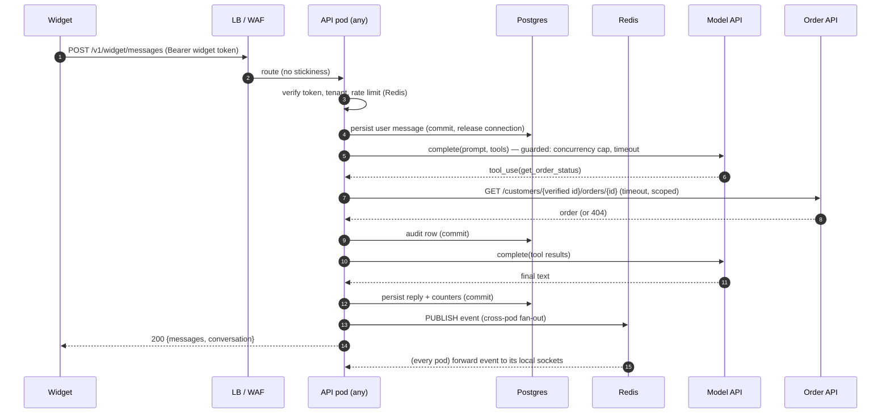
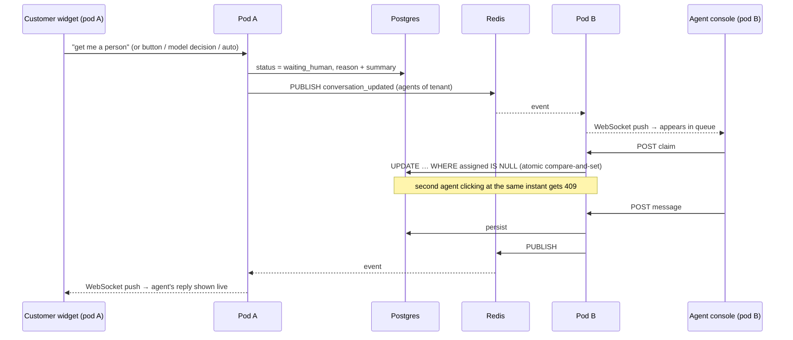

# Scaling & production operations — designing for ~30,000 conversations/day


*(Source: [`diagrams/build_system_design.py`](diagrams/build_system_design.py). Every number below is reproducible: `python -m capacity.model` for the model, `python -m loadtest.run` for measurements.)*

Contents: [1 Scope & assumptions](#1-scope--assumptions) · [2 Capacity model](#2-capacity-model) · [3 Architecture](#3-architecture-and-request-flows) · [4 Tier-by-tier scaling](#4-tier-by-tier-scaling) · [5 Reliability](#5-reliability-slos-failure-modes-ha-and-dr) · [6 Observability](#6-observability-and-alerting) · [7 Cost](#7-cost-model-and-levers) · [8 Rollout plan](#8-rollout-plan-and-triggers) · [9 Load test results](#9-load-test-results) · [10 Implemented vs roadmap](#10-implemented-vs-roadmap) · [11 Runbooks](#11-runbooks)

---

## 1. Scope & assumptions

**"30,000 tickets per day"** is interpreted as **30,000 support conversations per day** — each is a customer chatting with the assistant, some of which also create a Jira ticket (≈10 %) or are handed to a human (≈12 %). If you instead mean **30,000 Jira tickets/day**, the platform load is *lower* (a ticket is one write after a conversation) but the Jira side needs the treatment in [§4.5](#45-ticketing-jira): ≈0.35 tickets/s average, a few per second at peak.

All inputs are assumptions in [`capacity/model.py`](../backend/capacity/model.py) (`Assumptions`). Replace them with your own traffic data, then re-run.

| Assumption | Value | Basis / how to measure |
|---|---|---|
| Conversations/day | 30,000 | the requirement |
| Busiest-hour share | 15 % (flat day would be 4.2 %) | support traffic is strongly diurnal; measure from current inbox/chat logs |
| Busiest-minute vs peak-hour mean | 2× | bursts after marketing emails, outages, launches |
| **Design headroom** | **2× the busiest minute** | survives one availability zone loss + surprise growth |
| Customer messages per conversation | 6.5 | measure (`sp_turns_total` ÷ conversations) |
| Customer think time | 20 s | measure; affects open sockets, not request rate |
| Model calls per turn | 1.8 | ~60 % of turns call a tool first (`behavior` suite reports measured value) |
| Model call latency (median) | 3.5 s | provider dashboards; depends on model tier and effort |
| Input / output tokens per call | 3,400 / 260 | **replace with `behavior.avg_*_tokens_per_scenario`** after the first real eval run |
| Static (cacheable) prefix | ≈1,200 tokens | measured from the real prompt + tool schemas (chars ÷ 4 — use `count_tokens` for exact) |
| Handoff rate / ticket rate | 12 % / 10 % | measure in shadow mode; the single most expensive number (see §2) |

## 2. Capacity model

Output of `python -m capacity.model` (static prefix estimate measured from the code):

| Metric | Average | Peak (busiest minute) | **Design (2× peak)** |
|---|---|---|---|
| Conversations / s | 0.35 | 2.5 | **5.0** |
| Bot turns / s | 2.3 | 16.2 | **32.5** |
| Model calls / s | | 29.2 | **58.5** |
| Model calls in flight | | 103 | **205** |
| Concurrent open chats (WebSockets) | | 428 | **855** |
| DB commits / s | | 114 | **228** |
| WebSocket events / s | | 49 | **98** |

A turn takes ≈6.3 s end to end (almost all of it the model); a conversation lasts ≈170 s.

**What this means**

* **The platform is small.** ~33 turns/s and ~230 commits/s is modest for a stateless async API plus Postgres. Compute is not the scaling problem.
* **The model API is the main technical constraint:** ≈205 model calls in flight and ≈59 calls/s at the design point. Confirm your provider **rate limits and concurrency quotas** cover this (manual item M-11) and keep a fallback.
* **Humans are the dominant cost and capacity risk.** With a 12 % handoff rate: **3,600 handoffs/day ≈ 480 agent-hours/day ≈ 100 FTE**, ~90 agents online in the peak hour. Each percentage point of handoff rate is ≈40 agent-hours/day. Handoff *precision* (HO-2), deflection quality and KB coverage therefore matter more to the P&L than any infrastructure choice. Plan staffing (M-12), routing, queue SLAs and an overflow path (collect details → ticket → follow up) before launch.
* **Storage is small:** 450k messages/day ≈ 164 M/year ≈ 115 GB/year of message rows — one Postgres instance with monthly partitions and a retention policy.

## 3. Architecture and request flows

Tiers (see diagram): **clients → edge (CDN, WAF, L7 LB) → stateless API Deployment → data tier (Postgres + PgBouncer, Redis, object storage) → external services (model API, Jira, customers' order APIs, webhooks)**, with **a separate outbox-worker Deployment** and an observability band.

Design properties:

1. **API pods are stateless.** Everything shared lives in Postgres or Redis. Any pod can serve any request; autoscale by CPU and in-flight turns; no sticky sessions.
2. **Async I/O end to end** (FastAPI/uvicorn, async SQLAlchemy, async HTTP, thread-pool only for the synchronous `jira` client). A pod holds hundreds of turns in flight while they wait on the model.
3. **A request never waits on a slow dependency without a bound** (model call timeout 60 s, queue timeout 20 s, order API timeout 8 s, Jira 15 s) and **never holds a DB connection while waiting** (§9).
4. **Degrade toward a human, never toward silence:** model unavailable/overloaded/refusing, runaway tool loop → apology + hand-off. Tracker down → ticket parked in the outbox with a reference number.
5. **Authorization is enforced in the app on every call**, so adding replicas, regions or caches never creates a new place where identity can be forgotten.

### 3.1 A customer turn



### 3.2 Hand-off to a human, across pods



### 3.3 Ticket with outbox (Jira slow or down)

```mermaid
sequenceDiagram
    participant A as API pod
    participant J as Jira
    participant DB as Postgres
    participant W as Outbox worker
    A->>J: create issue (label sp-<idempotency key>)
    J--xA: 503 / timeout (retryable)
    A->>DB: INSERT ticket_outbox (pending) — commit
    A-->>A: tool result: queued, reference REQ-n  → customer told honestly
    loop every few seconds
        W->>DB: due rows → UPDATE status=processing WHERE pending (atomic claim)
        W->>J: search label sp-<key> (did a timed-out create actually succeed?)
        alt exists
            J-->>W: SUP-123
        else not yet
            W->>J: create issue
        end
        W->>DB: ticket row, status=done; backoff 30 s→1 h on failure
        W-->>A: system message in chat: "Your ticket SUP-123 has been created" (via Redis)
    end
    Note over W,DB: after 8 attempts → dead-letter → hand off to a human
```

## 4. Tier-by-tier scaling

### 4.1 Model API (the binding constraint)

| Concern | Mechanism | Status |
|---|---|---|
| Don't melt the provider quota or our pods | `GuardedLLM`: per-pod concurrency semaphore (`LLM_MAX_CONCURRENCY`, default 64), 20 s queue timeout, 60 s call timeout | ✅ implemented, tested |
| Overload/timeouts | typed errors (`overload`, `timeout`, `error`) → turn degrades to human hand-off; metric `sp_llm_calls_total{result}` | ✅ |
| Fleet-wide concurrency | per-pod cap × pods ≥ 205 in-flight at design load: **4 pods × 64 = 256 (recommended 5 for N+1)**; this, not CPU, sets the pod count (§9) | ✅ config |
| Tail latency / outages | secondary model on `overload`/`timeout` (`ANTHROPIC_FALLBACK_MODEL`) | ✅ implemented (see §10) |
| Cost | prompt caching on the per-tenant static prefix (tools + system); history capped to the last 30 messages; short, tool-focused prompts | ✅ caching split; cap ✅ |
| Cost/latency tiering | route simple FAQ turns to a cheaper/faster tier (Sonnet/Haiku) and keep the strongest model for order/ticket/handoff reasoning — **only after the behavior suite shows no regression on that tier** | roadmap |
| Quota planning | request provider limits ≥ 2× design (≈120 calls/s, ≈410 M input tokens/hour… see §7); keep a second account/region as break-glass | manual M-11 |
| Time to first byte | token streaming to the widget (perceived latency) | roadmap |

Prompt caching specifics: current models cache prefixes ≥ 512 tokens; the static prefix here is ≈1,200 tokens. The breakpoint is at the end of the per-tenant static prompt; the date and "signed in as …" come *after* it so conversations of a tenant share the entry. Entries live 5 minutes and refresh on each hit, so busy tenants stay warm; a tenant with < 1 request / 5 min pays the 1.25× write each time (still cheap). **Verify it works** with `sp_llm_tokens_total{kind="cache_read"}` — if zero, something is invalidating the prefix.

### 4.2 API tier

* **Sizing:** start with 3 pods (3 AZs), 2 vCPU / 2 GB each, uvicorn with 1 worker per pod (scale horizontally; async handles concurrency). Two limits apply: measured throughput (≈40 turns/s per process on SQLite, §9 — re-measure with Postgres) and **model-concurrency slots** (pods × `LLM_MAX_CONCURRENCY` ≥ ≈205 in-flight calls); the larger requirement wins, and it must hold *with one pod failed* (N+1).
* **Autoscaling signals (HPA/KEDA):** CPU > 60 %, **in-flight turns per pod** (`sp_llm_inflight` + waiting) and `sp_llm_waiting` > 0 for 1 minute. Scale-out before scale-in: min 3, max set by DB connection budget (§4.3), stabilization window 5 min on scale-down.
* **Graceful shutdown:** `terminationGracePeriodSeconds` ≥ 90 s so in-flight turns (≤ 60 s) finish; readiness flips to failing first so the LB stops sending traffic. WebSockets reconnect with jittered exponential backoff (widget does 0.5 s → 15 s) and refetch missed state on reconnect, so deploys cause a brief, self-healing reconnect wave, not message loss.
* **Reconnect storms:** after a pod/zone loss ~⅓ of ~855 sockets reconnect within seconds. Cheap (a JWT check + one DB read), but keep `maxSurge` ≥ 1 and use connection draining at the LB.
* **File descriptors / memory:** ~855 sockets at design load ÷ pods is tiny; set `ulimit -n` ≥ 10k anyway for 10× growth.
* **Config:** `DB_POOL_SIZE`, `DB_MAX_OVERFLOW`, `LLM_MAX_CONCURRENCY`, `MESSAGES_PER_MINUTE`, `REDIS_URL`, `LOG_FORMAT=json`, `RUN_OUTBOX_WORKER` (set `false` on web pods when running dedicated workers).

### 4.3 Database (Postgres)

* **Pooling — the rule that matters most:** *a turn must not hold a connection while it waits on the model or any external system.* The app now commits/releases before every such wait (regression-tested). Therefore connections ≈ *concurrent DB statements*, not concurrent turns. Budget: `pods × (DB_POOL_SIZE + DB_MAX_OVERFLOW) ≤ ~70 % of Postgres max_connections`, and put **PgBouncer (transaction pooling)** in front so hundreds of pods/threads share tens of server connections.
* **Sizing:** design load is ≈230 commits/s, ≈1,000–1,500 statements/s. A single modern instance (e.g. 4–8 vCPU, 16–32 GB, provisioned IOPS/NVMe) handles this with large headroom. HA: synchronous standby in a second AZ, automated failover, PITR backups; **RPO ≈ 0 / RTO ≈ minutes** (verify in the DR drill, M-10).
* **Schema & indexes:** composite indexes already present for the agent queue (`tenant_id, status, handoff_at`), resume (`tenant_id, user_id, status, updated_at`), outbox due-scan (`status, next_attempt_at`), messages by conversation. Add a `(tenant_id, created_at)` index on `audit_log` for investigations.
* **Partitioning & retention:** `messages` and `audit_log` grow ≈164 M rows/year. Range-partition by month (native partitioning), keep N months hot (policy: ≥ 90 days for support, per your privacy review M-7), detach and archive older partitions to object storage, drop on schedule. Detach/drop is O(1) vs. mass deletes.
* **Read scaling:** agent queue/lists and analytics can read from a replica (small lag is fine for lists; a claim/reply always hits the primary). Wiring a read URL is a small change (roadmap, §10); not needed at this load.
* **Commits per turn:** a typical KB turn does 3 commits (user message, reply, counters); order/ticket turns add audit/ticket commits. If DB latency ever dominates, batch the end-of-turn writes into one transaction (≈2 commits) — measured first, not assumed.
* **Migrations:** the app currently calls `create_all()` on start (fine for first install). Production needs versioned migrations (Alembic) with expand → deploy → contract discipline so rolling deploys stay compatible (roadmap, **required before the first schema change**).

### 4.4 Real-time (WebSockets) and Redis

* Events are published to Redis channels; **each pod keeps one `PSUBSCRIBE sp:*` and fans out to its local sockets** — cost grows with pods, not with sockets. At design load that is ≈100 events/s total: trivially small for Redis.
* **Failure behaviour:** if Redis is unreachable, publishing falls back to *local* delivery (same-pod sockets still work), the listener reconnects with backoff, rate limiting **fails open**, `/readyz` reports `redis: degraded` (not fatal). Cross-pod live delivery pauses; clients recover state on reconnect/refetch, and no message is lost because Postgres is the source of truth.
* **HA:** managed Redis with replica + automatic failover (data is ephemeral; pub/sub and counters only). **At ≫10× scale** or if you need delivery guarantees, move events to a stream (Redis Streams/NATS/Kafka) and have pods consume from consumer groups.
* **Idle timeouts:** LB idle timeout must exceed the client ping (25 s); set 60–120 s.

### 4.5 Ticketing (Jira)

* Tickets are created inline when the tracker is healthy (so the customer sees the key immediately) and **through the outbox when it isn't** (§3.3). `jira` is a synchronous library → run in worker threads (`asyncio.to_thread`); size the default executor (≥ 16) if you expect bursts.
* **Rate limits:** Jira Cloud rate-limits per app/user and returns `429 Retry-After`. At 30k tickets/day (0.35/s average, perhaps 3–5/s in a burst) you are normally far below limits, but a bulk-incident burst can exceed them: the outbox absorbs it and drains at a rate the worker controls (`OUTBOX_POLL_SECONDS`; 20 rows per poll). Add a global token bucket if you run many tenants against one Jira.
* **Idempotency:** each issue carries a label `sp-<key>`; retries first search by that label so a timed-out-but-successful create is never duplicated. Failures are classified **retryable** (timeouts, 408/425/429/5xx) vs **permanent** (400/401/403 — misconfiguration): permanent errors are not queued forever.
* **Dead letters:** after 8 attempts (~hours) the row is `dead`, the customer is told, and the conversation is handed to a human. Alert on `sp_ticket_outbox_pending` depth/age.
* **Another tracker:** implement the one-method `TicketProvider` protocol; the outbox, idempotency and metrics come for free.

### 4.6 Knowledge base & retrieval

* Each pod holds each tenant's BM25 index **in memory** (a few MB per tenant; reloaded on `POST /v1/admin/tenants/reload`). Up to a few hundred tenants this is fine. For thousands, load lazily with an LRU, or externalise to a search service.
* **Uploads:** the admin API writes to the tenant directory on the *receiving pod's* disk — for multi-pod production put tenant config and knowledge on shared storage (object store synced at start / mounted volume) or an index service, and publish a "reload" event. **Until then use one config source of truth (git → deploy) rather than live uploads in a multi-pod setup.**
* **Quality at scale:** retrieval is lexical. As KBs grow, move to hybrid (BM25 + embeddings, e.g. pgvector) behind `KnowledgeBase.search()`; the retrieval and behavior suites are the regression harness.

### 4.7 Multi-tenancy at scale

* **Isolation is enforced in code and tested** (every query is tenant-scoped; separate secrets per tenant; 10 tenant-isolation cases in the security suite).
* **Noisy neighbours:** per-conversation rate limiting exists; add **per-tenant** quotas (requests/s, model concurrency share) before onboarding tenants with very different volumes (roadmap).
* **Per-tenant observability:** metrics carry a low-cardinality `tenant` label; dashboards per tenant for handoff rate, KB-miss rate, model errors, latency. Never label by conversation or user.
* **Blast radius:** a broken tenant YAML is skipped (tested), not fatal. Per-tenant canary (model/prompt version) is a roadmap item.

### 4.8 Human agents and queues

Not an infra problem but the largest operational one (§2). Needs: skills/priority routing, business-hours messaging (the handoff message should say when a person will actually answer), a queue-age alert (e.g. oldest `waiting_human` > 5 min), overflow ("we'll email you" → ticket), and workload balancing. Today the queue is oldest-first per tenant with atomic claim.

## 5. Reliability: SLOs, failure modes, HA and DR

**Proposed SLOs** (agree with the business, then alert on burn rate):

| SLI | Target |
|---|---|
| Availability of widget API (non-5xx, excluding 429) | 99.9 % monthly |
| Bot turn latency p95 (excluding model) | < 500 ms; end-to-end p95 < 12 s |
| Turns ending in `error` | < 0.1 % |
| Authorization violations | **0** (page on 1) |
| Tickets filed within 15 min of request (outbox included) | 99.5 % |
| Live message delivery to open sockets (p95) | < 1 s |

**Failure modes and designed behaviour** (each is exercised by the resilience suite or unit tests):

| Failure | Behaviour | Customer sees |
|---|---|---|
| Model API down / 429 / timeouts | fallback model, else hand-off | apology + human joins |
| Model refusal | hand-off | "bringing in a teammate" |
| Jira down / rate-limited | outbox + backoff + idempotency | reference REQ-n, then "ticket SUP-n created" |
| Order API down | tool returns `order_system_unavailable` | "can't reach the order system right now" |
| Redis down | local delivery, fail-open limiter | slight delay in live updates; refresh recovers |
| Postgres primary failure | `/readyz` red → LB drains; failover; pods reconnect (`pool_pre_ping`) | brief errors/retries during failover |
| One AZ lost | remaining pods serve (≥ 2× headroom) | none |
| Pod killed mid-turn | request fails; widget retry/refetch; user message already persisted | message appears; resend if needed |
| Bad deploy | readiness fails / canary guardrails → rollback | none |
| Bad tenant config | tenant skipped, others unaffected | that tenant unavailable until fixed |

**DR:** PITR + cross-region snapshot copies; infrastructure as code; secrets in a manager with documented rotation; a **restore drill** that measures actual RPO/RTO (M-10). Multi-region active/active is not needed at this load; pilot-light/warm-standby in a second region (Postgres cross-region replica + the same images) covers regional loss.

## 6. Observability and alerting

`GET /metrics` (Prometheus text; optional `METRICS_TOKEN`), `GET /healthz` (liveness, no dependencies), `GET /readyz` (DB + Redis), JSON logs (`LOG_FORMAT=json`). Key series:

| Metric | Use |
|---|---|
| `sp_turns_total{tenant,outcome}`, `sp_turn_seconds` | throughput, error rate, latency (answered / handoff / error) |
| `sp_http_request_seconds{route,method,status}` | per-route latency/error |
| `sp_llm_calls_total{model,result}`, `sp_llm_call_seconds`, `sp_llm_inflight`, `sp_llm_waiting` | provider health, saturation, autoscaling |
| `sp_llm_tokens_total{model,kind}` (`input/output/cache_read/cache_write`) | **cost** and cache-hit ratio |
| `sp_tool_calls_total{tool,outcome}` | tool health |
| `sp_handoffs_total{tenant,trigger}` | **why** people reach humans (model/phrase/button/auto_unanswered/llm_error/…) |
| `sp_tickets_total{tenant,provider,result}`, `sp_ticket_outbox_pending` | ticketing health, backlog |
| `sp_order_lookups_total{tenant,result}`, `sp_authz_violations_total` | usage and **the security canary (must be 0)** |
| `sp_kb_searches_total{tenant,match}` | docs gaps / retrieval regressions |
| `sp_ws_connections{kind}` | open sockets |

Example alert rules (PromQL; tune windows to your traffic):

```promql
# page: any authorization violation
increase(sp_authz_violations_total[5m]) > 0
# page: turn error ratio
sum(rate(sp_turns_total{outcome="error"}[5m])) / sum(rate(sp_turns_total[5m])) > 0.005
# page: model failing or saturated
sum(rate(sp_llm_calls_total{result=~"error|timeout|overload"}[5m])) / sum(rate(sp_llm_calls_total[5m])) > 0.05
# warn: turns waiting for a model slot (scale out / raise quota)
avg_over_time(sp_llm_waiting[2m]) > 0
# warn: ticket backlog growing
sp_ticket_outbox_pending > 50 and deriv(sp_ticket_outbox_pending[15m]) > 0
# warn: p95 turn latency
histogram_quantile(0.95, sum by (le) (rate(sp_turn_seconds_bucket[5m]))) > 12
# info: prompt cache not working
sum(rate(sp_llm_tokens_total{kind="cache_read"}[1h])) == 0
```

Logs never include tokens or message bodies by default; the `audit_log` table records who looked up which order and who filed what. Add request-id propagation and OpenTelemetry traces (pod → worker → provider) as the next observability step.

## 7. Cost model and levers

From `python -m capacity.model` (list prices as of the cached 2026-10-06 reference; verify before budgeting; assumes 3,400 input / 260 output tokens per call, 1.8 calls per turn, 90 % cache hits on the ≈1.2k-token static prefix):

| Model | $/day | $/conversation | $/month |
|---|---|---|---|
| `claude-opus-5-5` | ≈ 5,200 | ≈ 0.17 | ≈ 157,000 |
| `claude-sonnet-5-5` | ≈ 2,650 | ≈ 0.088 | ≈ 80,000 |
| `claude-haiku-5-5` | ≈ 130 | ≈ 0.0044 | ≈ 4,000 |

Compare with humans: 100 FTE of agents for handoffs dwarfs model spend for Sonnet/Haiku-class models. **Levers, in order of impact:**

1. **Handoff rate and precision** — each point ≈ 40 agent-hours/day (§2). Better KB, better retrieval, better prompts, correct escalation.
2. **Model tier** — choose by *measured* quality: run the behavior suite on each tier; ship the cheapest that passes every gate. Haiku-class is ~40× cheaper than Opus-class per conversation here.
3. **Prompt caching** — saves ≈20 % at the assumed prefix share; the saving grows with a longer tenant-specific static prompt/policy block. (Report `cache_read` ratio.)
4. **Tokens per call** — trim history (cap 30 messages today; summarise older turns), keep passages tight (top-k, relevance floor), terse tool outputs, `effort` setting (`ANTHROPIC_EFFORT`).
5. **Avoid unnecessary calls** — deterministic fast paths (explicit "human" requests already skip the model).
6. **Batch** is not applicable (interactive), except for offline evals.

Measure rather than trust: after the first real evaluation, put the *measured* tokens/calls per scenario (`behavior.avg_*`) into `Assumptions` and re-run the model.

## 8. Rollout plan and triggers

| Phase | Shape | Move on when |
|---|---|---|
| **0 — today** | single process, SQLite, in-memory hub (demo/dev) | — |
| **1 — launch** | 3 API pods + 2 workers, managed Postgres (HA) + PgBouncer, managed Redis, CDN/WAF/LB, dashboards & alerts, canary rollout | all gates in [EVALUATION.md](EVALUATION.md) §7 + manual items |
| **2 — growth (≈3×)** | HPA on in-flight turns; read replica for lists; monthly partitions + retention job; per-tenant quotas; shared tenant config/knowledge storage; Alembic migrations | queue wait or DB CPU > 60 % sustained; > 20 tenants |
| **3 — ≈10× (300k/day)** | hybrid/vector retrieval service; events on a stream; sharded or larger Postgres (or Citus); dedicated model-routing service; multi-region warm standby | single-primary write latency p95 > 25 ms or Redis pub/sub saturation |

## 9. Load test results

> **Scope of these numbers.** One uvicorn process, SQLite (`aiosqlite`) on local disk, no Redis, a 4-vCPU / 16 GB sandbox shared with the load generator, simulated model (lognormal, median 2.5 s). They measure *our application code under a realistic concurrency shape*. They are **not** a Postgres/Redis/multi-pod result — repeat on staging (commands in EVALUATION.md §8) before citing capacity to the business.

**Ramp (open-loop, steady-state window per step)** — measured 2026-10-12T06:48:32+00:00  
_uvicorn x1 process, SQLite (aiosqlite) on local disk, 4 vCPU sandbox shared with the load generator, no Redis, simulated model median 2.5s, LLM_MAX_CONCURRENCY=1000_

| Offered conv/s | Steady turns/s | Errors | p50 / p95 / p99 total (ms) | p50 / p95 / p99 platform overhead (ms) | Verdict |
|---|---|---|---|---|---|
| 4.0 | 27.5 | 0 (0.00 %) | 4143 / 7977 / 9998 | 36 / 127 / 304 | ✅ within gates |
| 6.0 | 40.5 | 0 (0.00 %) | 4463 / 8001 / 10131 | 70 / 362 / 994 | ✅ within gates |
| 9.0 | 51.5 | 0 (0.00 %) | 4451 / 8319 / 10241 | 237 / 1211 / 2089 | ❌ saturated |

* Highest step within gates: **40.5 turns/s per process**; the design point needs **32.5 turns/s** → capacity ratio **1.246** for one process.
* `replicas needed at design load ≈ ceil(32.5 / 40.5) = 1` (before N+1 headroom; assumes linear scaling until the shared database saturates — to be confirmed on staging).

**WebSocket soak**

| Open sockets | Delivered | p50 / p95 / p99 / max reply→socket (ms) |
|---|---|---|
| 1000 / 1000 | 1000 (100.0 %) | 693 / 1383 / 2154 / 2782 |


**What the load testing found (in order) — and what it means**

1. **A real application bug, now fixed.** The first ramp collapsed at ≈1.6 conv/s (p95 platform overhead 33 ms → 2.4 s). Cause: each in-flight turn kept a **database connection checked out for the whole model call** (an auto-begun read transaction was never closed), so concurrency was capped at the default pool size (15). It would have been fatal at the design point (≈205 turns in flight). Fixed by ending the transaction before every wait on the model, the ticket tracker and the order API; guarded by three regression tests that assert *zero checked-out connections* during those waits. No unit test had caught it — only realistic concurrency did.
2. **A flaw in my own measurement, also fixed.** My first fix-verification used 15 s steps while a conversation lasts ≈40 s, so the server never reached steady state and "turns/s" was divided by a wall-clock that included the drain — it overstated capacity. The tool now uses a 75 s arrival window, excludes a 45 s warm-up, and measures only the steady-state window. (Mentioned because the first "good" numbers were wrong and should not be quoted.)
3. **The per-pod model-concurrency cap is a throughput ceiling, by design.** With the default `LLM_MAX_CONCURRENCY=64` and a 2.5 s model, a pod can run at most 64 / 2.5 / 1.8 ≈ **14 turns/s** (measured: 14.1–14.4), no matter how idle its CPU is; beyond that, turns queue (p95 total latency 29 s) and, after the 20 s queue timeout, degrade to a human hand-off. That is the guard working — but it means **pod count is set by model slots, not CPU**: `pods ≥ ceil(in-flight calls ÷ cap)` = ceil(205 ÷ 64) = **4**, recommended **5** with N+1. Raise the cap (it only costs memory) once the provider quota supports it. Queue wait is now reported separately from model latency (`timing.queue_ms`, so it counts as platform overhead and shows up as saturation).
4. **Platform ceiling on this hardware.** With the cap lifted (1,000), one process sustained **40.5 turns/s within all gates** (error 0 %, p95 overhead 362 ms) — **1.25× the 32.5 turns/s design point** — and saturated between 40 and 51 turns/s (p95 overhead 1.2 s, still 0 errors). *The saturating resource was not profiled* (CPU of the single event loop and SQLite commit serialisation are the suspects; the load generator shares the 4 vCPUs). Treat ≈40 turns/s/process as a conservative planning input for the capacity model, and re-measure on staging.
5. **WebSockets:** 1,000 simultaneous sockets (≈1.2× the design point's 855) all connected and **100 % of agent replies were delivered, p95 1.4 s, max 2.8 s** — measured as a worst-case burst (1,000 replies fired at once through a single SQLite-backed process; the real rate is ≈100 events/s, so steady-state delivery will be far faster). Cross-pod delivery via Redis was verified functionally against a real `redis-server` but **not** load-tested here.

**Gate status (EVALUATION §7):** LD-1 error rate 0 % ✅ · LD-2 p95 overhead 362 ms ≤ 500 ✅ · LD-3 capacity ratio 1.25 ≥ 1.0 ✅ — **for one process on SQLite with a simulated model**. These gates are *not* satisfied for the real deployment until the same run passes on staging (3+ pods, Postgres + PgBouncer, Redis, real network), because that is where connection limits, commit latency and cross-pod fan-out show up. Reproduce:

```bash
# server (staging-like):  LLM_PROVIDER=simulated SIM_LLM_MEDIAN_SECONDS=2.5 LLM_MAX_CONCURRENCY=1000 MESSAGES_PER_MINUTE=100000 ...
python -m loadtest.run ramp --user-secret <secret> --start-rate 4 --step-factor 1.5 --note "<what you ran>"
python -m loadtest.run ws --sockets 1000
python -m loadtest.render        # markdown tables above
```


## 10. Implemented vs roadmap

| Capability | State | Evidence |
|---|---|---|
| Stateless async API; tenant-scoped queries; pool config | ✅ | code + tests |
| Redis pub/sub hub + shared rate limiter (fail-open/degrade) | ✅ | tests against a **real redis-server** |
| Atomic agent claim (DB compare-and-set) | ✅ | concurrency test (10 simultaneous claims, 1 winner, 1 "joined" message) |
| Ticket outbox, backoff, idempotency label, dead-letter → human | ✅ | tests incl. 4 workers racing |
| LLM guard (concurrency cap, queue/call timeouts), fallback model | ✅ | tests |
| No DB connection held across model/tracker waits | ✅ | regression tests (found by the load test) |
| Prometheus metrics, `/healthz`, `/readyz`, JSON logs | ✅ | tests |
| Prompt-cache split (static prefix + dynamic suffix) | ✅ | unit-tested request shape; **cache-hit ratio must be verified against the live API** |
| Eval gates, load tester, capacity model | ✅ | `evals/`, `loadtest/`, `capacity/` |
| Postgres in production | ⚠️ **unverified** — no Postgres instance in the build environment; code uses portable SQLAlchemy, pool settings are Postgres-only | run the suite + load test on staging Postgres |
| Real model & real Jira | ⚠️ **unverified here** (no credentials) | eval suites + smoke on staging |
| Alembic migrations | ⛔ roadmap (required before first schema change) | — |
| Per-tenant quotas / per-tenant model & prompt canary | ⛔ roadmap | — |
| Read-replica routing, monthly partitions, retention job | ⛔ roadmap (DDL guidance in §4.3) | — |
| Shared tenant config/knowledge storage for multi-pod uploads | ⛔ roadmap (use git→deploy meanwhile) | — |
| Streaming responses; widget feedback (👍/👎); SSO for agents; OpenTelemetry traces | ⛔ roadmap | — |
| Hybrid/vector retrieval | ⛔ roadmap (trigger: retrieval gates degrade) | retrieval suite is the harness |

## 11. Runbooks

**Model provider incident** (`sp_llm_calls_total{result≠ok}` rising): confirm on provider status; if partial, lower `LLM_MAX_CONCURRENCY` to stop hammering and let fallback absorb; if full outage, customers are being handed to humans automatically — notify support leads, post a banner via tenant `waiting_message`, expect handoff spike (agents!). After recovery nothing to replay (conversations are intact).

**Jira outage:** no action needed for correctness. Watch `sp_ticket_outbox_pending`; after recovery the worker drains it (rate-limited). If rows go `dead` (> ~hours), a human already got the conversation; re-file from the transcript. For a planned Jira maintenance window you can pre-emptively stop the worker (`RUN_OUTBOX_WORKER=false`) to avoid burning attempts.

**Redis outage:** chat continues; live cross-pod updates pause (agents may need to refresh the queue). Restore Redis; sockets reconnect and refetch. No data loss.

**Postgres failover:** `/readyz` fails → LB drains; standby promoted; `pool_pre_ping` revives connections; expect a short burst of 5xx/429. Verify `sp_turns_total{outcome="error"}` returns to baseline; check outbox depth.

**Reconnect storm / thundering herd after deploy or AZ loss:** widget backs off with jitter; if pods saturate, temporarily raise replicas and LB connection limits; avoid restarting all pods at once (`maxUnavailable` ≤ 25 %).

**Handoff queue backlog:** alert on oldest `waiting_human` age; options in order: pull more agents, switch the tenant's `waiting_message` to async "we'll email you", raise the auto-escalation threshold (`max_unresolved_turns`) only if the bot is demonstrably handling the intents, enable the "collect details → ticket" overflow path.

**Suspected authorization issue** (`sp_authz_violations_total` > 0 or a customer report): treat as a security incident — rotate the tenant's `user_token_secret`, disable order tools for the tenant (`orders.provider: none` + reload), pull `audit_log` (`order_lookup`, `order_ownership_violation`) for the window, run `python -m evals.run --suites security`, and reproduce before re-enabling.
